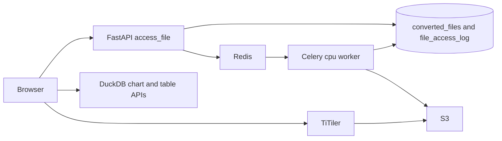

# Visualization: built, remaining, and how to finish it

The portal already has a separate preview path from downloads. `/api/access_file` never increments download counts or writes `file_download_log`. Conversion metadata, status polling, DuckDB charts, TiTiler hints, and the preview page are in place. What is not live is the format matrix you described, and the transform still runs inside the Celery worker instead of Lambda.

## Already built

**Access path, separate from downloads**

- [`src/api/routers/visualization.py`](src/api/routers/visualization.py): `GET /access_file`, `GET /access_file/status`, `GET /access_file/schema`, `GET /access_file/table`, `POST /access_file/chart`.
- [`src/api/services/visualization.py`](src/api/services/visualization.py) `access_file`: if a `converted_files` row is `available`, presign it and log access; if `processing` and not stale, return that status; if the native file is already cloud-native, record it as `available` and presign the original key; otherwise insert `processing` and enqueue `cpu.convert_file`.
- Stale jobs (older than the task time limit) and conversion failures are marked `removed`. The status endpoint returns `error` for timeout and failure. The preview page polls every 2s for up to that same window.

**Tables** in [`src/api/models/converted_file.py`](src/api/models/converted_file.py) and migration [`src/api/migrations/versions/20260921_converted_files.py`](src/api/migrations/versions/20260921_converted_files.py):

- `converted_files`: `cloud_file_id`, `native_file_id`, `bucket`, `file_key`, `format`, `created_on`, `last_accessed`, `status` (`processing` | `available` | `removed`).
- `file_access_log`: `cloud_file_id`, `native_file_id`, `accessed_time`, `user_id`.

**Expiry.** `AUTO_REMOVE_CONVERTED_FILES` defaults to false and `CONVERTED_FILES_EXPIRY_TIME_DAYS` defaults to 30 in [`src/api/core/config.py`](src/api/core/config.py). Hourly `cpu.purge_expired_converted_files` deletes S3 objects whose `last_accessed` is older than that, only when the flag is true.

**Charts.** DuckDB runs in the API process over the Parquet object in S3. Column names and aggregations are whitelisted. The client never sends SQL.

**TiTiler.** Deployed beside the app, proxied at `/titiler/`. When `TITILER_BASE_URL` is set and the viewer is `raster_map`, the payload adds `titiler_url`, `bidx`, `rescale`, and `colormap_name`.

**Frontend.** [`src/web/src/pages/FilePreview.jsx`](src/web/src/pages/FilePreview.jsx) switches on `viewer` and lazy-loads the component. Packages already in [`src/web/package.json`](src/web/package.json) and dynamically imported: `d3`, `react-pdf`, `react-map-gl` / `maplibre-gl`, `flatgeobuf`, `pmtiles`. Dataset info already renders a collapsible file card and, when expanded, a green dot from `cloud_native_available` ([`src/web/src/pages/DatasetInfo.jsx`](src/web/src/pages/DatasetInfo.jsx) around the cloud-native metadata row).

**Converters already written** in [`src/api/services/conversion.py`](src/api/services/conversion.py), but only reachable if `plan_for_format` returns a plan:

- LibreOffice headless → PDF
- DuckDB → Parquet (CSV/TSV directly; XLSX via DuckDB `excel`, with a LibreOffice-to-CSV fallback)
- GDAL `ogr2ogr` → FlatGeobuf at or under 100k features, PMTiles above that
- `gdal_translate -of COG` (rio-cogeo only if GDAL is missing)

## Remaining

**1. Format routing is intentionally closed.** [`plan_for_format`](src/api/services/formats.py) returns `None` for every geospatial token and for Excel. [`test_conversion_plan.py`](src/api/tests/test_conversion_plan.py) asserts that. The API then responds 400, dataset info sends `viewer: null`, and [`previewExcluded`](src/web/src/pages/DatasetInfo.jsx) hides the eye icon and the green dot for those same types. Vector, raster, and XLSX code never runs.

Target routing:

- `pdf` → `document`, no conversion
- `docx`, `doc`, `pptx`, `html`, `xml`, `txt`, `markdown` → `document`, convert to PDF (already routed, including a few extra office types)
- `csv`, `xlsx` → `table_chart`, convert to Parquet (`csv` already routed)
- `parquet` → `table_chart`, no conversion (already routed)
- `geojson`, `gpkg` / GeoPackage, GeoParquet → `vector_map`, convert to FlatGeobuf or PMTiles
- FlatGeobuf, PMTiles → `vector_map`, no conversion
- GeoTIFF that is not already a COG → `raster_map`, convert to COG
- COG → `raster_map`, no conversion

Shapefile, KML, and the other geo tokens stay unsupported. They are not in this matrix.

**2. Transforms still run on the Celery host.** [`src/api/Dockerfile.conversion`](src/api/Dockerfile.conversion) installs LibreOffice and GDAL and runs `cpu.convert_file` in-process. There is no Lambda function. A compromised or pathological file can still take down that worker. Lambda’s max timeout is 15 minutes; the task limit today is 2100 seconds, so the stale-job window has to come down to match Lambda.

**3. Viewer gaps once those formats are enabled**

- PMTiles sets no `maxBounds`. FlatGeobuf does, with a half-degree pad ([`VectorMapViewer.jsx`](src/web/src/components/visualize/VectorMapViewer.jsx)).
- The PMTiles layer is hard-coded to `source-layer="default"`, which GDAL often does not use.
- An already-COG GeoTIFF is not detected, so it would be reconverted.
- If `ogrinfo` fails, feature count is treated as 0 and a huge layer is written as FlatGeobuf.

**Not adding `pypdfium2` or `preview-file`.** Office files become PDFs on the server. `react-pdf` already renders that PDF. `pypdfium2` is a PDF renderer, not a DOCX/PPTX converter. `preview-file` is unused and is not required once the browser only receives PDF, Parquet-backed chart data, or map tiles.

## How to implement it

### Format plans

In [`src/api/services/formats.py`](src/api/services/formats.py), stop excluding `xlsx` and the formats in the matrix. Return:

- `xlsx` → `FormatPlan(table_chart, cloud_native=False, parquet, parquet)`
- `geojson`, `geopackage`, `geoparquet` → `(vector_map, False, flatgeobuf, vector)` (final extension is chosen by the converter)
- `flatgeobuf`, `pmtiles` → `(vector_map, True, <same>, none)`
- `cog` → `(raster_map, True, cog, none)`
- `geotiff` → `(raster_map, False, cog, cog)`

Leave shapefile, KML, and other `_GEO_TOKENS` excluded. Update [`src/api/tests/test_conversion_plan.py`](src/api/tests/test_conversion_plan.py) so `xlsx` and `geojson` return plans, and add cases for PMTiles, FlatGeobuf, COG, and GeoTIFF.

In [`DatasetInfo.jsx`](src/web/src/pages/DatasetInfo.jsx), drop `xlsx`, `geojson`, `gpkg`, GeoParquet, FlatGeobuf, PMTiles, GeoTIFF, and COG from `previewExcluded`. The existing green dot then appears when that file’s metadata is expanded, because dataset info already fills `viewer` and `cloud_native_available` from `plan_for_format`.

### Lambda for the transform

Keep the Celery `cpu` worker as the control plane only: it owns the `converted_files` row, retries, timeout marking, and the hourly purge. It does not run LibreOffice, GDAL, or DuckDB on untrusted bytes.

Add `CONVERSION_RUNTIME` (`local` or `lambda`, default `local`) and `CONVERSION_LAMBDA_FUNCTION_NAME` in [`src/api/core/config.py`](src/api/core/config.py) and [`env.template`](env.template).

- `local`: today’s path, so dev compose keeps working without AWS.
- `lambda`: [`cpu.convert_file`](src/api/tasks/cpu.py) calls `lambda:InvokeFunction` (`RequestResponse`) with the bucket, native key, destination key, and conversion kind. The function downloads, calls the existing `convert_native`, uploads, and returns `{ok, format}` or `{ok: false, error}`. The worker writes `available` or `removed`. The function has S3 read/write only, no database credentials, so a bad file cannot touch Postgres or the API process.

New handler module next to the tasks, for example `src/api/lambda_convert.py`, plus a Lambda container target on [`src/api/Dockerfile.conversion`](src/api/Dockerfile.conversion) using the AWS Lambda runtime interface (`awslambdaric`). Image contents stay LibreOffice, `gdal-bin`, and the `visualization` extra (DuckDB). Set the function timeout to 900 seconds, memory around 4–10 GB, and ephemeral storage large enough for the native file plus the output. Lower the Celery soft/hard limits and `CONVERSION_TASK_TIME_LIMIT` to sit just under 900 seconds so the status endpoint and the Lambda timeout agree.

IAM, not application code: the worker role may invoke that function; the function role may `GetObject` / `PutObject` on the data bucket.

Inside the converter, before a GeoTIFF COG job, check with `gdalinfo` whether the file is already a COG. If it is, skip the translate and let the worker point `file_key` at the native object (same pattern as other cloud-native files). If feature count cannot be read, fail the vector job instead of assuming it is under 100k.

### Frontend map bounds

In [`VectorMapViewer.jsx`](src/web/src/components/visualize/VectorMapViewer.jsx), read the PMTiles header (`minLon` / `minLat` / `maxLon` / `maxLat`, and `vector_layers` for the real source-layer name) and set `maxBounds` from that extent, matching the FlatGeobuf path. Raster maps already set `maxBounds` from the TiTiler `/bounds` response.

### What stays as it is

- `/api/download_url` remains the only path that logs downloads and increments counts.
- Chart and table SQL stay server-side.
- Document viewing stays `react-pdf` after LibreOffice conversion.
- Image, text, and media viewers stay as extra viewers beyond the four in the spec.
- Purge behavior stays gated on `AUTO_REMOVE_CONVERTED_FILES` and `last_accessed`.
