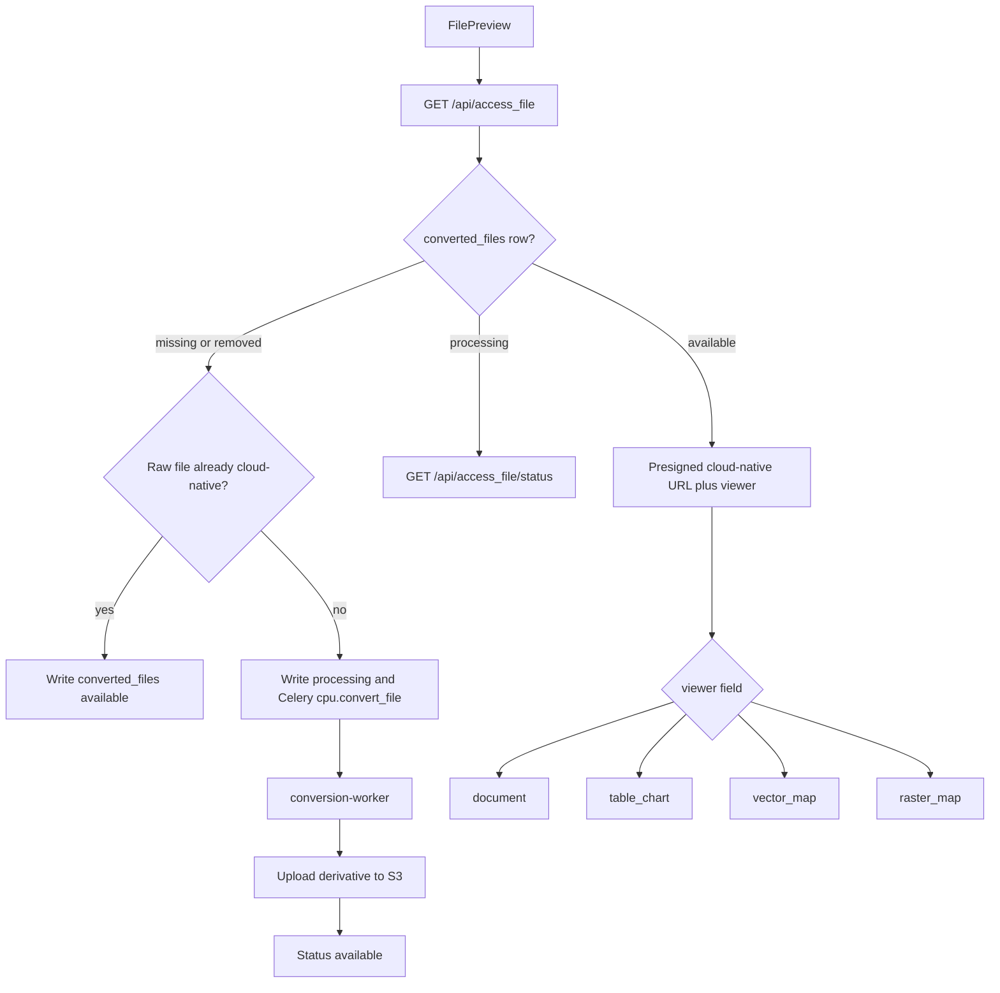

# Visualization implementation (what landed)

This is a record of the visualization work already in the repo. The old in-browser preview path was replaced so visualization no longer uses `/api/download_url` (and no longer increments download counts).

## What was reverted

- Removed `/api/preview_url` from [src/api/routers/upload.py](src/api/routers/upload.py) and [src/web/src/api/endpoints.js](src/web/src/api/endpoints.js).
- Removed client-side `xlsx` parsing and SVG charts from [src/web/src/pages/FilePreview.jsx](src/web/src/pages/FilePreview.jsx).

## Access flow

Same visibility rules as download. Visualization writes `file_access_log` only. Download still uses `/api/download_url`.

## Backend

- Tables in [src/api/models/converted_file.py](src/api/models/converted_file.py) and migration [src/api/migrations/versions/20260921_converted_files.py](src/api/migrations/versions/20260921_converted_files.py):
  - `converted_files`: `cloud_file_id`, `native_file_id`, `bucket`, `file_key`, `format`, `created_on`, `last_accessed`, `status` (`processing` | `available` | `removed`)
  - `file_access_log`: `cloud_file_id`, `native_file_id`, `accessed_time`, `user_id`
- Env in [src/api/core/config.py](src/api/core/config.py) and `.env`: `AUTO_REMOVE_CONVERTED_FILES` (default false), `CONVERTED_FILES_EXPIRY_TIME_DAYS` (default 30, used only when auto-remove is true, based on `last_accessed`), `TITILER_BASE_URL`
- Endpoints in [src/api/routers/visualization.py](src/api/routers/visualization.py):
  - `GET /api/access_file`
  - `GET /api/access_file/status`
  - `GET /api/access_file/schema`
  - `GET /api/access_file/table`
  - `POST /api/access_file/chart` (server-built DuckDB SQL; no raw SQL from the client)
- Format plan in [src/api/services/formats.py](src/api/services/formats.py):

  | Native | Target | Viewer |
  |---|---|---|
  | pdf | none | document |
  | docx, pptx, doc, html, xml, txt, markdown | pdf | document |
  | csv, xlsx | parquet | table_chart |
  | parquet | none | table_chart |
  | GeoJSON, GeoPackage, GeoParquet | FlatGeobuf up to 100k features, else PMTiles | vector_map |
  | FlatGeobuf, PMTiles | none | vector_map |
  | GeoTIFF | COG | raster_map |
  | COG | none | raster_map |

- Conversion runs only on the isolated `cpu` queue: [src/api/tasks/cpu.py](src/api/tasks/cpu.py), [src/api/celery_cpu_worker.py](src/api/celery_cpu_worker.py), [src/api/Dockerfile.conversion](src/api/Dockerfile.conversion), `conversion-worker` in docker-compose. Tools: LibreOffice, DuckDB, GDAL, gdal_translate/rio-cogeo.
- Dataset info now includes `viewer`, `cloud_native_status`, `cloud_native_available` in [src/api/routers/dataset.py](src/api/routers/dataset.py).

## Frontend

- [src/web/src/pages/FilePreview.jsx](src/web/src/pages/FilePreview.jsx) calls `/api/access_file`, polls status, then lazy-loads a viewer from `payload.viewer`.
- Viewers under [src/web/src/components/visualize/](src/web/src/components/visualize/):
  - `DocumentViewer` — react-pdf
  - `TableChartViewer` — D3 charts; table/chart data from the API
  - `VectorMapViewer` — react-map-gl / MapLibre (FlatGeobuf or PMTiles), panning limited to source extent
  - `RasterMapViewer` — TiTiler tiles with `bidx`, `rescale`, `colormap_name`
- [src/web/src/pages/DatasetInfo.jsx](src/web/src/pages/DatasetInfo.jsx): expanded file metadata shows a green dot when the cloud-native file is available.

## Still needed to run it

- `cd src/api && uv lock` (DuckDB was added to [src/api/pyproject.toml](src/api/pyproject.toml); lockfile was not regenerated here)
- `alembic upgrade head`
- Restart frontend; start `conversion-worker`
- Set `TITILER_BASE_URL` for raster maps
