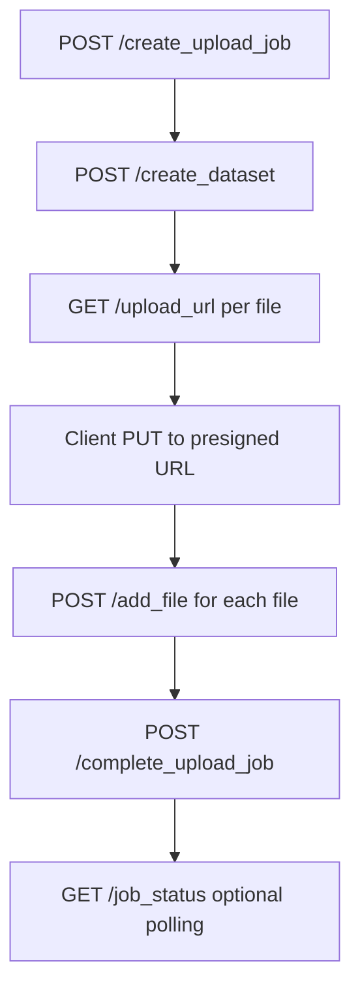
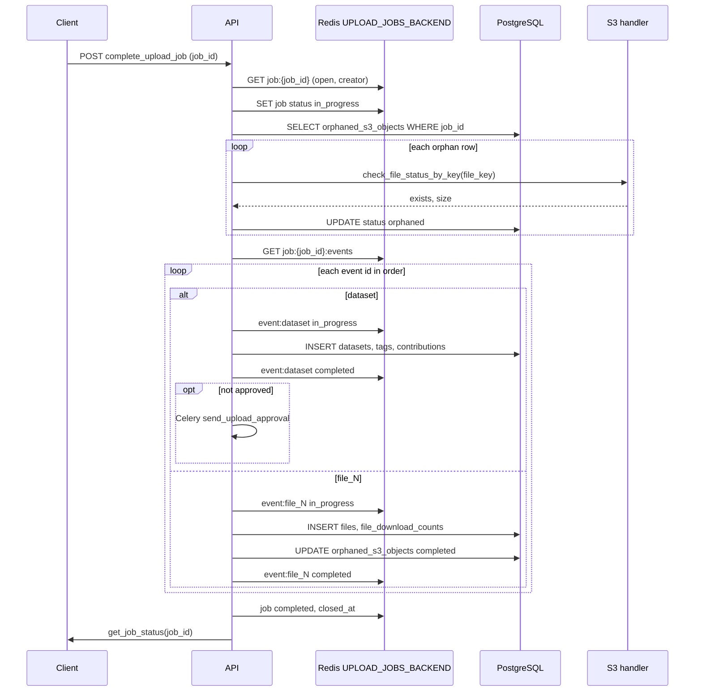

# Dataset upload job pipeline

This document describes the **upload job** workflow: staging work in Redis (dedicated instance), tracking presigned S3 uploads in PostgreSQL, then **committing** dataset and file rows in one completion step.

All **job-scoped Redis keys** use the URL from **`UPLOAD_JOBS_BACKEND`** in settings (`src/api/core/config.py`) — **not** the session/cache `REDIS_URL`. The async client is provided by `get_upload_jobs_redis()` in `src/api/services/auth.py`.

TTL for job keys is **`UPLOAD_JOB_CACHE_AGE_SECONDS`** (default 86400 unless overridden in `.env`).

---

## Configuration

| Setting | Purpose |
|--------|---------|
| `UPLOAD_JOBS_BACKEND` | Redis URL for keys `job:*` only |
| `UPLOAD_JOB_CACHE_AGE_SECONDS` | Expiry (seconds) on `job:{id}`, `:events`, `:event:*`, and lock refresh |
| `UPLOAD_APPROVAL_TEMPLATE_ID` | Brevo transactional template for `send_upload_approval` emails |

---

## Redis key model (upload jobs DB)

| Key | Contents |
|-----|----------|
| `job:{job_id}` | JSON job metadata: `job_id`, `creator`, `full_name`, `organization`, `status` (`open` → `in_progress` → `completed` / `completed_with_errors`), `created_at`, `expires_at`, `closed_at` |
| `job:{job_id}:events` | JSON array of event id strings, e.g. `["dataset","file_1","file_2"]` — **processing order** for completion |
| `job:{job_id}:event:dataset` | JSON payload for the dataset creation step (see below) |
| `job:{job_id}:event:file_N` | JSON payload for the Nth file metadata step (`add_file`) |
| `job:{job_id}:lock` | Short-lived lock (`SET NX EX ~3`) for appending to `:events` |

Missing keys or expired TTLs behave like “job not found” for that operation.

---

## Table: `orphaned_s3_objects`

Tracks S3 objects that exist (or should exist) **before** a row exists in `files`. Implemented in `src/api/models/orphaned_s3_object.py`.

| Column | Description |
|--------|-------------|
| `file_id` | UUID, primary key — same id returned to the client from presign |
| `job_id` | Upload job UUID (matches Redis job; no FK to a SQL “jobs” table) |
| `file_key` | S3 object key (e.g. `{user_id}/{filename}`) |
| `bucket` | Bucket name (typically `S3_BUCKET`) |
| `created_at` | Timezone-aware timestamp |
| `status` | Lifecycle: **`initiated`** after presign → **`orphaned`** after S3 verified at completion → **`completed`** after `files` row is written |

---

## End-to-end flow (client perspective)

1. **Create job** — allocates `job_id`, seeds Redis.
2. **Create dataset (staged)** — writes `event:dataset` only; **no** `datasets` row yet.
3. **Upload URL** — presign + insert `orphaned_s3_objects` (`initiated`).
4. **Add file (staged)** — append `file_N` event; **no** `files` row yet.
5. **Complete job** — verify S3 for all orphan rows, insert `datasets` / `files`, emails, close job.
6. **Job status** — read aggregated Redis state for UI or polling.

---

## `POST /create_upload_job`

**Auth:** Session cookie (`get_current_active_user`).

**Behavior (controller `UploadController.create_upload_job`):**

1. **`UserService.check_if_user_verified_by_id`** — if false → **403**  
   `detail`: email/organization verification pending.
2. Generate `job_id` (UUID string).
3. Write **`job:{job_id}`** with `status: "open"`, `creator`, `full_name`, `organization`, timestamps, `expires_at`, etc.
4. Write **`job:{job_id}:events`** as JSON `[]`.
5. Both keys get TTL = `UPLOAD_JOB_CACHE_AGE_SECONDS`.

**Typical response:** `job_id`, `creator`, `expires_at`.

---

## `POST /create_dataset`

**Auth:** Session cookie.  
**Router:** `src/api/routers/dataset.py`.

**Form-style fields:** `title`, optional `description`, optional `private` (default false), `tags` (list), **`job_id`** (required).

**Behavior (`DatasetController.create_dataset`):**

1. Load **`job:{job_id}`** from upload-jobs Redis — missing → **404** `job {job_id} does not exist.`
2. Compare session user to Redis: **`creator`** and **`organization`** must match → else **403**.
3. Duplicate **`"dataset"`** in **`job:{job_id}:events`** is detected during the atomic append (see step 7) → **409**.
4. Resolve org via **`DatasetService.get_organization_with_private_status`** — enforces org exists / errors per service.
5. Effective **private** flag: if org disallows private catalogs, forced to `false` without error.
6. New **`dataset_id`** = `uuid4()`. **Approval:** high-role users get `approved=True` and `approved_by`; others default unapproved.
7. Atomically append **`"dataset"`** to **`job:{job_id}:events`**, **`SET`** **`job:{job_id}:event:dataset`**, and **`EXPIRE`** **`job:{job_id}`** (same TTL; job JSON is not rewritten) via Lua (duplicate → **409**).
8. Payload includes (`event_id`, `type: create_dataset`, `status: pending`, dataset fields, tags, …) with TTL on the event key.

**No insert into `datasets` at this step** — only Redis.

**Response:** `{ "job_id", "dataset_id" }`.

---

## `GET /upload_url`

**Auth:** Session cookie.

**Expected query parameters:** **`job_id`** (UUID), **`filename`**.

**Behavior (`UploadController.get_upload_url`):**

1. Sanitize and validate **`job_id`** as UUID.
2. **`job:{job_id}`** must exist → else **404**. **`creator`** must match signed-in user → else **403**.
3. Sanitize **`filename`**, basename-only (no path segments).
4. **`UploadService.check_file_exists`** — if file already present for user → **409** `File already exists`.
5. New **`file_id`** = `uuid4()`.
6. **`UploadService.get_presigned_upload_url`** — build same **`file_key`** as today: `{user_id}/{sanitized_basename}`.
7. **Insert `orphaned_s3_objects`** with `status="initiated"`, `job_id`, `file_key`, `bucket`, `file_id`.
8. **Response:** `{ "job_id", "file_id", "presigned_upload_url" }` (URL taken from S3 handler JSON).

Client uploads bytes to the presigned URL **before** calling `add_file` / `complete_upload_job`.

---

## `POST /add_file`

**Auth:** Session cookie.

**Form fields include:** **`job_id`**, **`file_id`** (from `/upload_url`), **`dataset_id`**, file metadata (`file_title`, `file_description`, `file_format`, temporal fields, `permissions`, `value`, etc.) — **no** `file_key` in the job-based flow; key is resolved later from `orphaned_s3_objects` at completion.

**Behavior (`UploadController.add_file`):**

1. **`job:{job_id}`** exists; **`creator`** matches user.
2. If **`"dataset"`** is in **`job:{job_id}:events`** **and** **`job:{job_id}:event:dataset`** exists: require **`dataset_id`** in the form to match the staged JSON → else **400**.
3. Otherwise (missing **`event:dataset`**, or **`"dataset"`** not in `:events`, or both): **PostgreSQL** — row for **`dataset_id`** must exist and **`creator`** must be the signed-in user → else **403** (`dataset does not exist or inadequate permission`).
4. Validation: title, format length ≤ 50, optional provenance/source truncation with logging, permissions via allow-list, `value` ∈ {high, medium, low} or default `low`, temporal ordering, etc.
5. Acquire **`job:{job_id}:lock`** (`SET NX EX`), compute next id `file_{max+1}`, append to **`job:{job_id}:events`**, **`EXPIRE`** **`job:{job_id}`** (refresh TTL only), release lock; retry with backoff on contention.
6. **`SET job:{job_id}:event:{event_id}`** with full `add_file` payload, `status: pending`.

**No** `files` or `file_download_counts` rows here; **no** S3 existence check; **no** dataset cache invalidation.

**Response:** `{ "job_id", "file_id" }`.

---

## `POST /complete_upload_job`

**Auth:** Session cookie.  
**Implementation:** `complete_upload_job` in `src/api/services/upload_completion.py` (called from the upload router with `job_id`, DB session, upload-jobs Redis, services).

**Input:** **`job_id`** (query or body, depending on route registration).

**Steps:**

1. **Preconditions**
   - `job:{job_id}` missing → **404** `job {job_id} does not exist.`
   - `status` ≠ `"open"` → **409** `job {job_id} is not open`
   - `creator` ≠ session user id → **403**
   - Set job `status` → **`in_progress`** (canonical job fields only; no `updated_at` or event counters on `job:{job_id}`), TTL refresh.

2. **Orphan + S3 gate**
   - Select all **`orphaned_s3_objects`** with this `job_id`.
   - For each row, **`upload_service.check_file_status_by_key(file_key)`** — if not in S3 → **400** `file {file_key} has not been uploaded.` (abort)
   - Store sizes for later `files.file_size`; set row **`status`** from **`initiated`** → **`orphaned`**.

3. **Process `job:{job_id}:events` in order**
   - **`dataset`:** set event `in_progress` → insert **`datasets`** row → **`attach_tags_to_dataset`** (validates dataset exists, replaces tag links) → **PostgreSQL upsert** on **`user_contributions`** (`ON CONFLICT (user_id) DO UPDATE` increment) → write event **`completed`** to Redis **before** DB commit → **`commit`**. On failure: Redis event `failed` + `error`, DB rolled back. Approval emails sent **after** successful commit when not approved.
   - **`file_N`:** set event `in_progress` → load **`orphaned_s3_objects`** by `file_id` (missing row → **404** HTTP error) → insert **`File`** / **`FileDownloadCount`** → update orphan **`completed`** → Redis event **`completed`** **before** **`commit`**. On failure: event `failed` + `error`. **`duration`** is parsed defensively if the event stores non-numeric text. On **success**, the event’s **`dataset_id`** is added to the completion invalidation set so **`dataset:{dataset_id}`** can be cleared in auth Redis.

4. **Finalize**
   - `job:{job_id}` → `status`: **`completed`** if every event succeeded, else **`completed_with_errors`** (at least one event ended with `failed` in Redis). Set `closed_at` only (no `updated_at` on job meta).
   - Invalidate **`dataset:{dataset_id}`** in **auth** Redis (`REDIS_URL`) for every **`dataset_id`** that had a **successful commit** in this run: the **`dataset`** event (new **`datasets`** row), and each successful **`file_N`** event (new **`files`** row for an existing or newly created dataset). Failed events do not contribute their id to this set.

**Response:** **`get_job_status(job_id)`** JSON (same shape as below).

---

## `GET /job_status/{job_id}`

**Auth:** Should require session and match **`creator`** on `job:{job_id}` (recommended; avoids leaking job metadata by id).

**Behavior:**

1. Call **`get_job_status(job_id, redis)`** from `src/api/services/upload_job.py`.
2. If result contains **`"error"`** (e.g. missing job) → **404** with `detail=status["error"]`.
3. Else return **200** with job JSON including **`events`**: list of `{event_id: status}` dicts.

---

## Helper: `get_job_status(job_id, redis)`

Async function in `src/api/services/upload_job.py`:

1. `GET job:{job_id}` — if missing, return `{"error": "Job not found"}`.
2. Parse JSON job meta.
3. `GET job:{job_id}:events` → list of event ids (default `[]`).
4. For each id, `GET job:{job_id}:event:{id}` → read **`status`**; append `{event_id: status}`. If key missing, status **`unknown`**.
5. Attach **`events`** to job dict and return.

---

## Celery: `send_upload_approval`

Defined in `src/api/tasks/email.py` (`email.send_upload_approval`).

- **Template:** `settings.UPLOAD_APPROVAL_TEMPLATE_ID`
- **Args:** `email`, `title`, `name` (Brevo `params`: `title`, `name`).

---

## Completion flow (diagram)

---

## Related source files

| Area | Path |
|------|------|
| Upload routes / controller | `src/api/routers/upload.py` |
| Create dataset (job) | `src/api/routers/dataset.py` |
| Job status helper | `src/api/services/upload_job.py` |
| Completion orchestration | `src/api/services/upload_completion.py` |
| Upload Redis dependency | `src/api/services/auth.py` (`get_upload_jobs_redis`) |
| Settings | `src/api/core/config.py` |
| Orphan model | `src/api/models/orphaned_s3_object.py` |
| Email task | `src/api/tasks/email.py` |

---

## Operational notes

- **Order matters:** `job:{job_id}:events` defines commit order; typically **`dataset`** first, then **`file_1`**, **`file_2`**, …
- **Completion is not idempotent:** The first successful **`POST /complete_upload_job`** moves **`job:{job_id}.status`** from **`open`** → **`in_progress`** → **`completed`** or **`completed_with_errors`**. A second complete call receives **409** `job {job_id} is not open`.
- **Client retry guidance:** Before retrying completion after timeouts or network errors, call **`GET /job_status/{job_id}`** (or inspect the last response). Only retry **`POST /complete_upload_job`** if **`status`** is still **`open`**. If the job is **`in_progress`**, **`completed`**, or **`completed_with_errors`**, do not resubmit completion; poll **`job_status`** until a terminal state is clear.
- **Partial failure:** If any event handler fails, that event’s Redis payload gets **`status: failed`** and an **`error`** message; the job may still finish with **`completed_with_errors`**. Inspect **`get_job_status`** `events` (and per-event keys under **`job:{job_id}:event:*`**) to see which steps failed. There is **no automatic resume or rollback** endpoint: operators must fix data (e.g. DB/S3) manually or start a **new** upload job. **`completed_with_errors`** means some events failed while others may have committed.
- **Cache:** Dataset info cache lives on **session** Redis; completion clears **`dataset:{uuid}`** when a **new dataset** was committed in the job and when **new file rows** were committed via successful **`file_N`** events (including file-only jobs with no **`dataset`** event).

### Database: `files.file_format`

Column width is **50** characters (Alembic revision `e7f8a9b0c1d2`) to support longer MIME-style or custom format labels in the upload-job pipeline.
